<div align="center">

<p><strong>iOS companion app</strong></p>
<p>
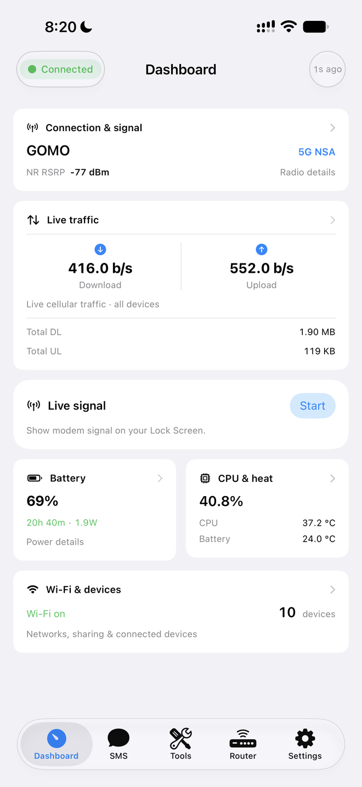&nbsp;&nbsp;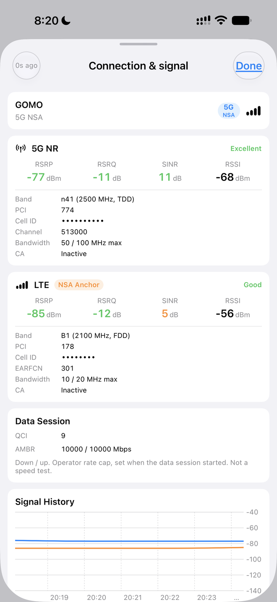&nbsp;&nbsp;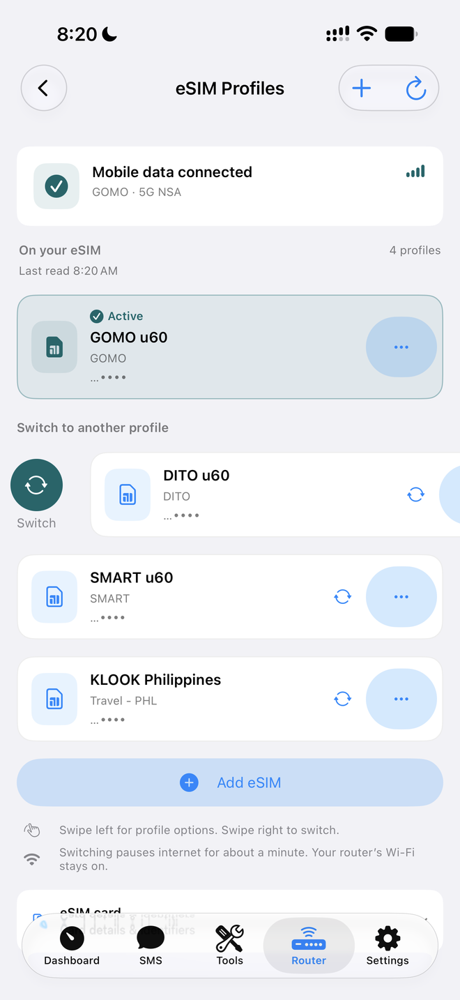
</p>

# ZTE U60 Pro Toolkit

**Unlock the full potential of your ZTE U60 Pro (MU5250) 5G mobile router.**

On-device agent with a REST API, live updates and a built-in web UI, plus native mobile
companion apps, for signal monitoring, band locking, config backup/decryption, network
customization, and more.

[](https://www.rust-lang.org/)
[-orange.svg)]()
[]()
[-green.svg)]()
[](https://open-u60-pro.vercel.app)
[](https://github.com/jesther-ai/open-u60-pro/releases/latest)

**Download:** [latest release](https://github.com/jesther-ai/open-u60-pro/releases/latest) · **What's new:** [CHANGELOG.md](CHANGELOG.md) · **Screenshots:** [by feature](#screenshots) · **Web UI:** [responsive console](#responsive-web-console)

</div>

---

## Device

| | |
|---|---|
| **Model** | ZTE U60 Pro (MU5250) |
| **Hardware** | `MU5250_HW1.0` |
| **Firmware** | `CN_ZTE_MU5250V1.0.0B27` (Oct 31, 2025) |
| **Chipset** | Qualcomm Snapdragon X75 (SDX75 / SDXPINN) |
| **CPU** | 4x Cortex-A55 (ARMv8.2-A) @ 2.2 GHz |
| **RAM** | 1.6 GB |
| **Storage** | 8 GB eMMC (Longsys JS08AC), 69 partitions, A/B slots |
| **Modem** | 5G-A Sub-6 + mmWave, Cat 22 LTE |
| **NR Bands** | n1/2/3/5/7/8/18/20/26/28/29/38/40/41/48/66/71/75/77/78/79 |
| **LTE Bands** | 1/2/3/4/5/7/8/18/19/20/26/28/29/32/34/38/39/40/41/42/43/48/66/71 |
| **WiFi** | WiFi 7 (802.11be), 2x2 MIMO, EHT160 |
| **WiFi Chipset** | Qualcomm WCN7851 (`qcacld32`) |
| **WiFi Radios** | 2.4 GHz (ch 1-13, EHT40, 19 dBm) · 5 GHz (ch 36-165, EHT160, 18 dBm) |
| **Battery** | 10,000 mAh Li-ion, 4.5V max, PM7550B fuel gauge |
| **Charging** | USB-PD, 15W (5V/3A), fast charge |
| **USB** | USB-C (PD sink, OTG/powerbank) |
| **Display** | 3.5" IPS LCD (Sitronix ST77926), 320x480, RGB565, DRM/KMS |
| **UI Toolkit** | LVGL with FreeType + LodePNG, assets at `/usr/ui/` |
| **Backlight** | AWINIC AW9523B (I2C `1-005b`), sysfs `/sys/class/leds/led:lcd/brightness` (0-255) |
| **Touch** | Sitronix (I2C `1-0055`) -> `/dev/input/event3` |
| **OS** | ZWRT (OpenWrt 23.05.4 r24012-d8dd03c46f) |
| **Kernel** | Linux 5.15.170-perf, SMP PREEMPT, aarch64 |
| **PMICs** | PMX75 + PM7550BA + PMG1110 |
| **SIM** | Single nano-SIM (no built-in eSIM; eSIM cards such as the 9eSIM B1 work in the slot) |
| **NFC** | Quick device pairing |
| **Bluetooth** | Qualcomm WCN7850 (BT 5.3+), UART transport — disabled (services stopped, module unloaded) |
| **Clients** | Up to 64 (32 per radio) |

## What's Included

### On-Device Agent (`zte-agent`)

A lightweight Rust HTTP server that runs directly on the router (port 9090, on the router's network and, if enabled, your tailnet). It turns ubus calls, AT commands and sysfs reads into a typed REST API for the mobile apps, streams live updates (`GET /api/events`, see [events.md](zte-agent/docs/events.md)), and serves a browser UI at `http://192.168.0.1:9090/` (see [Web UI](#web-ui)).

```bash
# Cross-compile for the device
cargo build --release --target aarch64-unknown-linux-musl -p zte-agent
```

**183 endpoints across 22 categories:**

| Category | # | Capabilities |
|---|---|---|
| Auth | 1 | Log in with the agent password (bearer token; rate limited) |
| Device | 18 | System info, battery, CPU, memory, thermal, charger, charge control, reboot, factory reset, power save, fast boot, auto sleep |
| Network | 9 | Signal strength (RSRP/SINR/RSRQ), speed, traffic stats, WAN/LAN status, rmnet, connected clients |
| Modem | 16 | Airplane mode, mobile data toggle, network mode (2G-5G), operator scan, manual registration, data usage, no-service and connection-watchdog policies |
| SMS | 5 | List, send, delete, mark read, storage capacity |
| SIM | 7 | SIM info, IMEI, PIN management, PUK unlock |
| Cell/Band | 19 | NR/LTE band locking, cell locking, neighbor scan, STC, signal quality detection |
| Router | 29 | DNS, LAN/DHCP, firewall, NAT, DMZ, UPnP, port forwarding, QoS, domain filter, APN profiles, VPN/ALG |
| WiFi | 4 | Status, SSID/password/channel/TX power, guest WiFi |
| USB | 3 | USB mode switching, powerbank control |
| Telephony | 15 | Voice calls (dial/hangup/answer/DTMF/mute), USSD codes, SIM Toolkit menus |
| eSIM | 13 | eSIM profiles (built-in SGP.22 LPA): list, switch (verified card → modem → data), rename, download from QR with preview/cancel, delete, operator receipts, card info |
| Speed Test | 4 | Server list, run test, progress tracking |
| DoH Proxy | 6 | DNS-over-HTTPS proxy, cache management |
| LAN Test | 3 | WiFi ping, download/upload throughput measurement |
| SMS Forwarding | 10 | Auto-forward rules, CRUD, test, log management, retry held forwards |
| System | 2 | Process list, kill bloatware |
| Scheduler | 5 | Scheduled/recurring jobs for any API action |
| Live updates | 1 | `GET /api/events`: Server-Sent Events of signal, traffic, battery, SIM, eSIM progress and more |
| Live Activity | 3 | Register/unregister the iOS Live Activity, status |
| Tailscale | 8 | Remote management: setup, login URL, enable/disable, config, logout, update |
| AT Terminal | 2 | Send AT commands, port info |

### Web UI (built into the agent)

Open `http://192.168.0.1:9090/` on the router's Wi-Fi for a dashboard, connection & signal, and the most-used settings, with nothing to install. See [Web UI](#web-ui).

### Responsive Web Console

Open **`http://192.168.0.1:9090/console/`** on the router’s network. The console is embedded in the agent binary, with no separate frontend server or cloud service. When LAN HTTPS is enabled, use `/console/` on that same HTTPS address. It uses the current agent’s rate-limited bearer sign-in, Host/Origin checks and elapsed-time session expiry; `/` opens this console, and old `/ui/` bookmarks redirect to it. HTTPS and certificate-install controls are in Settings → HTTPS & Install.

The five sections cover Dashboard, Network, SMS, Tools and Settings. They include LTE/NR carrier aggregation and SA/NSA, WAN IPv4/IPv6, offline statistics, Wi-Fi/mobile/APN settings, connected-device traffic and observed peaks, eSIM management, SMS actions/forwarding, operator scanning, diagnostics, LAN/DHCP, firewall, port forwarding, UPnP, DMZ and QoS. Only fields reported by the firmware are presented as measurements or limits. See the [screenshots](#new-responsive-web-ui) and [developer guide](zte-agent/docs/responsive-console.md).

### Mobile Companion Apps

Native apps that connect directly over WiFi -- no computer needed.

| | iOS | Android |
|---|---|---|
| **Framework** | SwiftUI | Jetpack Compose |
| **Min Version** | iOS 16.0 | Android 8.0 (API 26) |
| **Dependencies** | None (Apple frameworks only) | OkHttp, Hilt, Vico, kotlinx.serialization |
| **Features** | BandLock, Call, Clients, Config, Dashboard, DeviceInfo, Login, RouterSettings, Scheduler, Signal, SIM/STK/USSD, SMS, Tools, USBMode | BandLock, Clients, Config, Dashboard, DeviceInfo, Login, RouterSettings, Scheduler, Signal, SIM/STK, SMS, Tools, USBMode |
| **Tabs** | Dashboard, SMS, Tools, Router, Settings | Dashboard, SMS, Tools, Router, Settings |
| **Path** | `mobile/ios/OpenU60/` (109 Swift files) | `mobile/android/OpenU60/` (90 Kotlin files) |

## Screenshots

### New responsive Web UI

The Rust agent serves one responsive browser console at **`http://192.168.0.1:9090/`** (also `/console/`). Old `/ui/` bookmarks open the new console. The console has phone, tablet and desktop layouts, Light/Dark/System themes, streamed SSE updates, animated measurements and smooth page/dialog transitions. Phones keep all five main tabs available in the bottom bar, including short landscape layouts and keyboard changes.

**Desktop · Light**

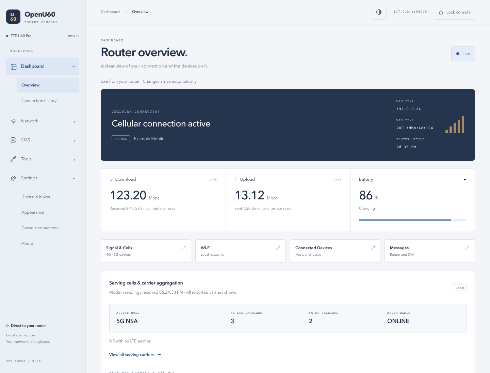

| Phone · Light | Tablet · Dark |
|:---:|:---:|
| 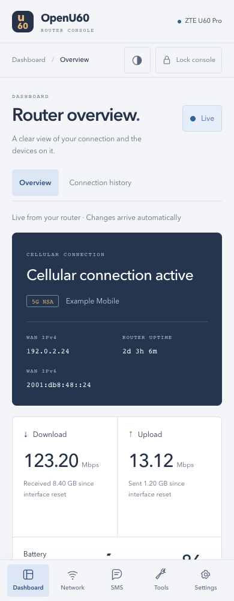 | 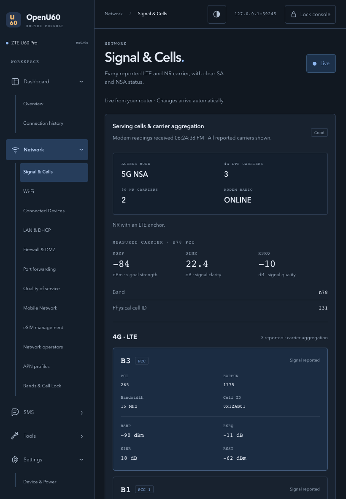 |

<details>
<summary>More Web UI previews: dark dashboard, connected devices and eSIM management</summary>

<p>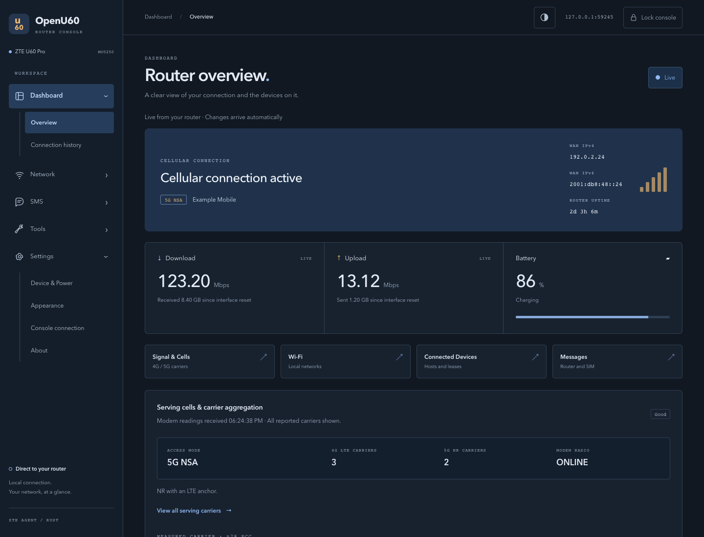</p>
<p>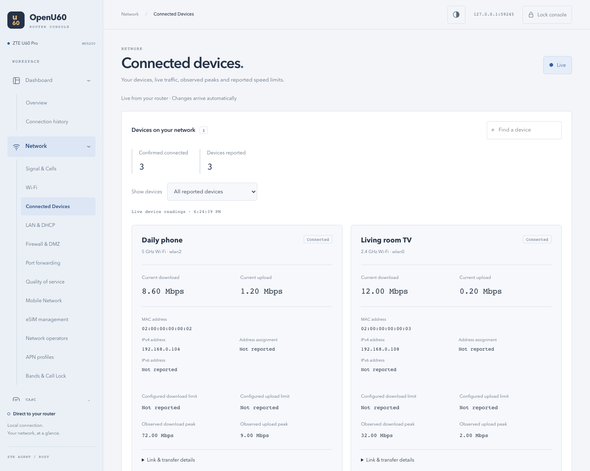</p>
<p>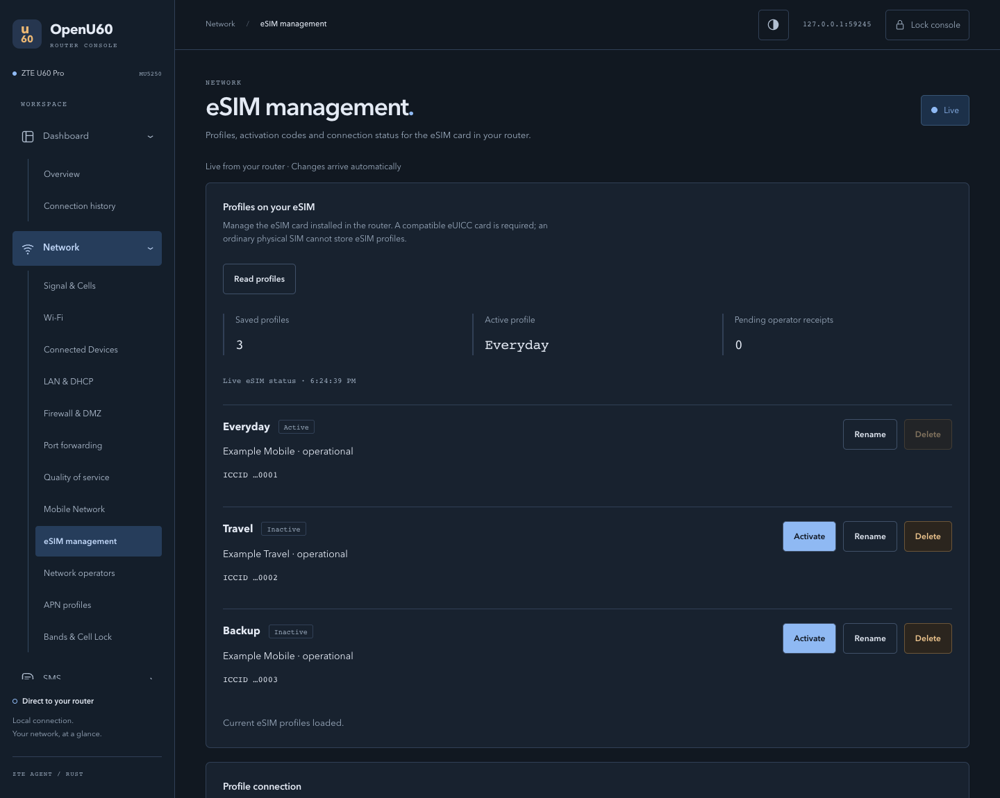</p>

</details>

These Web UI captures use **fictional demonstration data** and documentation address ranges. They contain no live router captures, passwords, messages or personal device identifiers. Per-device limits remain “Not reported” when firmware does not supply them. See [Responsive web console](#responsive-web-console) for setup and developer notes.

### iOS companion app

From the iOS app on iPhone. Personal identifiers (ICCID digits, cell IDs) are masked in these images.

#### Dashboard and signal

The Dashboard shows the operator, network type, live traffic, battery, CPU temperature and connected devices. Tap **Connection & signal** for 5G NR and LTE readings (RSRP, RSRQ, SINR, RSSI), band, channel, bandwidth, the operator's speed cap, and a signal history chart.

| Dashboard | Connection & signal |
|:---:|:---:|
|  |  |

#### eSIM profiles

With an eSIM card such as the [9eSIM B1](docs/9esim-b1.md) in the SIM slot, **Router → eSIM Profiles** lists the operator profiles on the card. Swipe right on a profile to switch to it; the app shows each step until mobile data is back. Setup: [eSIM profiles](#esim-profiles-optional).

| Profiles on the card | Switching profile |
|:---:|:---:|
|  | 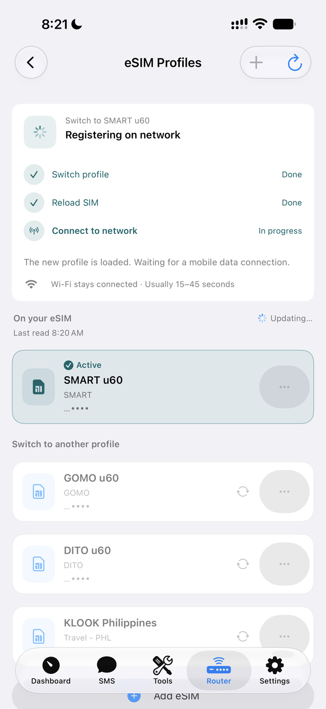 |

#### Battery and power

Battery details, USB-C mode (charge your phone from the router's battery), and device controls: charge limit, power-save mode, fast boot and auto sleep.

| Battery details | USB-C mode | Device controls |
|:---:|:---:|:---:|
| 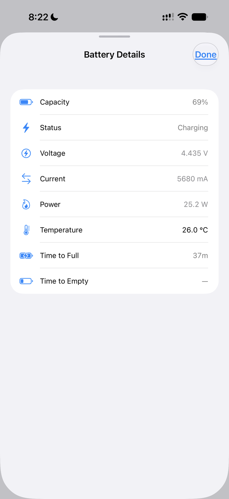 | 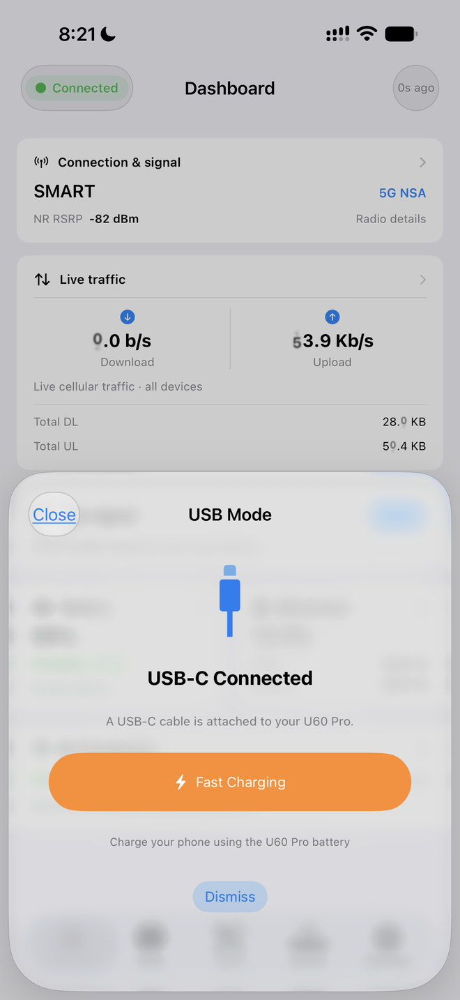 | 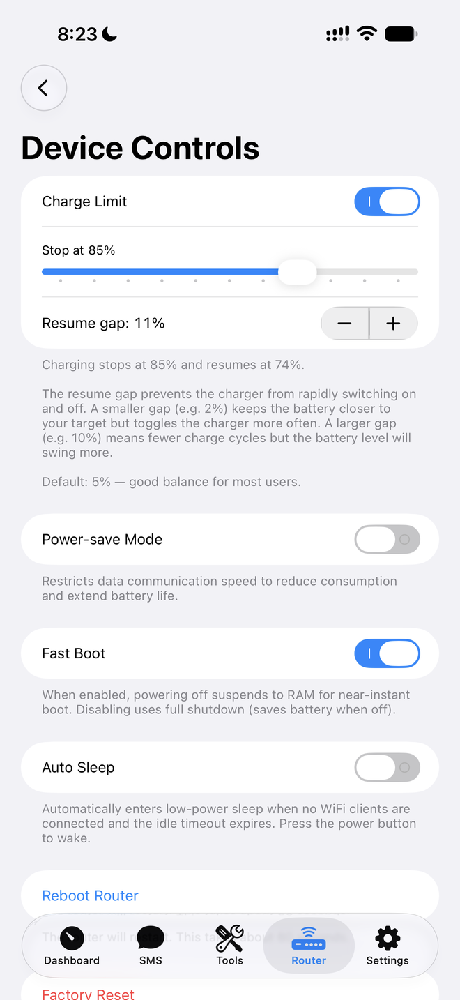 |

#### Lock Screen

Live modem signal on the Lock Screen and in the Dynamic Island: see [iOS Live Activities](#ios-live-activities).

## Why Use This Instead of the Official ZTE App?

The stock ZTE U60 Pro runs **44 proprietary daemons** consuming **225 MB of RAM** just for device management. Many of these are unnecessary (TR-069 remote management, MQTT telemetry, Samba, NFC, diagnostics) and phone home to ZTE servers.

`zte-agent` replaces the need for the official ZTE management app with a single ~5 MB binary:

| | zte-agent | ZTE Official Stack |
|---|---|---|
| **Processes** | 1 | 44 |
| **Memory (RSS)** | ~0.8 MB | 225 MB |
| **Binary size** | ~5 MB (~2.5 MB gzipped) | ~50+ MB combined |
| **Threads** | ~10 | ~130+ |
| **Telemetry** | None | Phones home to `iot.zte.com.cn` etc. |
| **App** | Open-source native iOS/Android | Closed-source, Chinese-only |

The official ZTE stack's top memory consumers:

| Process | RAM | Purpose |
|---------|-----|---------|
| `zte_topsw_devui` | 22.8 MB | LCD UI daemon |
| `zte_topsw_get_brand` | 14.2 MB | Carrier branding |
| `zte_topsw_data` | 10.9 MB | Mobile data management |
| `zte_topsw_tr069` + subs | 23.2 MB | ISP remote management |
| `zte_topsw_diag` | 7.1 MB | Diagnostics/logging |

zte-agent provides equivalent API access to the same underlying ubus/AT services using **0.35% of the memory** -- freeing ~224 MB of RAM for actual routing and WiFi workloads.

## Why a Built-In eSIM Manager Instead of lpac?

The eSIM feature first ran [lpac](https://github.com/estkme-group/lpac), the open-source eSIM manager, as a separate program on the router. To reach the card through the modem, lpac needs its own copy of GLib, libqmi, libqrtr, curl, OpenSSL and their dependencies (31 shared libraries in all), so it had to be cross-built into a 23.5 MB bundle and installed next to the agent. The agent then started a new lpac process for every card command, including every profile list the app asked for.

`zte-agent` now has the same eSIM code built in: lpac's card library translated to Rust ([`euicc/`](euicc/)) plus a small driver that talks to the modem directly. It adds about 130 KB to the agent.

Measured on the router (U60 Pro, 9eSIM B1, 2026-10-19):

| | Built into zte-agent | lpac bundle |
|---|---|---|
| **Install** | Nothing extra | Separate 23.5 MB bundle in `/data/lpac` (own musl loader + 31 shared libraries), built with a 1.4 GB cross-build setup |
| **Size on the router** | ~130 KB inside the agent binary | 23.5 MB |
| **Per card command** | A thread in the agent: ~2–3 ms CPU, no extra memory | A new process: ~20 ms CPU, ~10.7 MB peak memory |
| **`chip info`** | 0.15 s | 0.26 s |
| **`profile list`** | 0.25 s | 0.27 s (the card itself sets the pace) |
| **Operator server TLS** | Checked against the GSMA eSIM root only, host name checked, no redirects or proxy | Not checked by upstream lpac (`CURLOPT_SSL_VERIFYPEER` off); needed a patch |
| **Cancelling a download** | Cancel tells the operator "postponed", so the QR code stays usable; a timeout is reported as a timeout | Every stop is reported as "rejected by the user" |
| **Busy card** | Named (`catBusy`, `undefinedError`), so the agent knows to retry | "unknown" until patched |
| **Stopping a stuck command** | Time limit per step, inside the agent | SIGINT, then SIGKILL after 15 s |
| **License** | Agent MIT; eSIM library LGPL-2.1 | lpac's command-line tool is AGPL-3.0 |

The results are the same as lpac's. On the router, `chip info`, `profile list` and `notification list` gave identical output. About 1 million generated cases matched the C library. A download sends byte-for-byte the same card commands and server requests. Delete, download, switching and receipts have been tested on a real card (see [`zte-agent/docs/esim.md`](zte-agent/docs/esim.md)).

lpac is still the better tool elsewhere. It supports many card readers and modems (PC/SC, AT, MBIM, QMI) and more commands, such as SM-DS discovery, and it gets upstream fixes. The agent covers only what the app needs on this router, through the modem's QMI over QRTR, and is pinned to lpac commit `c7c8d4f`: upstream fixes have to be ported by hand. For a USB card reader on a computer, use lpac.

## Device Impact

> **Warning** -- The agent exposes device control endpoints that modify firmware settings.
> Destructive actions (factory reset, reboot) require confirmation in the mobile app.
> The web UI asks for confirmation before changes that can cut the connection or are destructive,
> and reboot and factory reset also need the agent password.

### Filesystem Layout

```
/data/                              (writable /data partition)
├── zte-agent                       <- on-device REST agent
├── zte-agent-tls/                  <- LAN HTTPS certificates (only once turned on; 0700)
└── local/tmp/
    ├── start_zte_agent.sh          <- agent boot script
    ├── dropbear                    <- SSH binary (if installed)
    └── start_dropbear.sh          <- SSH boot script (if installed)

/etc/                               (read-only rootfs)
├── rc.local                        <- boot hooks appended here
└── dropbear/
    ├── authorized_keys             <- SSH public key (if installed)
    └── dropbear_rsa_host_key       <- generated host key (if installed)
```

## Quick Start

### Prerequisites

```bash
# 1. Install Rust -- see https://rustup.rs
curl --proto '=https' --tlsv1.2 -sSf https://sh.rustup.rs | sh

# 2. Add musl cross-compilation target
rustup target add aarch64-unknown-linux-musl

# 3. Install musl cross-linker
# macOS:
brew install filosottile/musl-cross/musl-cross
# Ubuntu/Debian:
sudo apt install musl-tools gcc-aarch64-linux-gnu

# 4. Install ADB
# macOS:
brew install android-platform-tools
# Ubuntu/Debian:
sudo apt install android-tools-adb

# 5. Build the agent
cargo build --release --target aarch64-unknown-linux-musl -p zte-agent
```

### First-Time Setup

For a factory-fresh device that has never had zte-agent installed:

**Option A -- Browser (no tools needed)**

Visit [open-u60-pro.vercel.app](https://open-u60-pro.vercel.app), enter your router password and desired agent password, connect USB, and click Deploy. Requires Chrome or Edge.

**Option B -- Command line**

```bash
./setup.sh <router-password> <agent-password>
```

Enables ADB, builds and pushes the agent, creates boot scripts, and optionally sets up SSH for wireless deploys.

### Deploy Agent (subsequent updates)

```bash
./deploy.sh yourpassword
```

This builds, deploys the binary to the device via SSH (port 2222), updates the boot password, and restarts the agent.

### eSIM profiles (optional)

With an eSIM card in the SIM slot (tested with a [9eSIM B1](docs/9esim-b1.md)), the agent manages its operator profiles itself, as a GSMA SGP.22 eSIM manager built in (its card code is a Rust translation of [lpac](https://github.com/estkme-group/lpac)'s library); nothing else needs installing ([why not lpac](#why-a-built-in-esim-manager-instead-of-lpac)):

- **List** profiles and card details (EID, firmware, free space).
- **Switch** the active profile. The agent verifies each step (card → modem identity → mobile data) and reports why a switch didn't complete; it never switches back on its own. Internet returns in about 15–45 s; Wi‑Fi stays on.
- **Add** a profile from the operator's QR code or activation code, with a preview of the operator and profile name before anything is written, and cancel.
- **Rename** profiles (nicknames) and **delete** inactive ones.
- **Operator receipts:** the card's add, switch and remove notifications are sent to the operator's server one by one, right after the change once data is up, and retried while the router has mobile data.
- **Safety:**
  - one eSIM operation at a time;
  - checks that it's still the same card before any change;
  - no switching while you have airplane mode on;
  - downloads only with mobile data.
  - operator servers are reached over TLS checked against the GSMA eSIM root certificate that the card trusts.

Switching, adding, renaming and deleting require an agent password. In the apps: Router → eSIM Profiles. For diagnostics on the router, `/data/zte-agent esim-native chip info` (or `profile list`) prints one card command's result; it waits for nothing and answers busy while the agent uses the card. API and behaviour: [`zte-agent/docs/esim.md`](zte-agent/docs/esim.md). An lpac bundle in `/data/lpac` from earlier versions is no longer used and can be deleted.

### Connect Mobile App

1. Connect your phone to the router's WiFi
2. Open OpenU60 app
3. Set agent URL: `http://192.168.0.1:9090`
4. Enter the agent password you set above
5. No app? Open http://192.168.0.1:9090/ in a browser instead (see [Web UI](#web-ui)).

## Web UI

Connect to the router’s Wi-Fi or USB network and open **http://192.168.0.1:9090/**. Sign in with the agent password (`ZTE_AGENT_PASSWORD` in its startup script). The same responsive console works on phones, tablets and desktop computers. Old `/ui/` bookmarks redirect to the corresponding console screen; the old page, form and live-stream routes are retired.

The five sections are Dashboard, Network, SMS, Tools and Settings. They cover live connectivity and carrier aggregation, IPv4/IPv6, connected devices, Wi-Fi/mobile/APN settings, eSIM management, SMS and forwarding, network operators, battery/power details, diagnostics, LAN/DHCP, firewall/DMZ/UPnP, port forwarding, QoS and device controls. Data changes arrive over SSE. JavaScript is required; the console serves its own scripts, styles and fonts without a cloud service.

The sign-in token stays in this tab’s session storage, with an in-memory fallback when browser storage is unavailable. Navigation and reload retain it; locking, expiry or an agent restart requires a new sign-in. Theme preferences are separate from the token.

### Install it as an app

Open **Settings → HTTPS & Install** to enable HTTPS, renew its certificate or reset the router’s local certificate authority. The screen shows the router clock, expiry, public certificate fingerprints and HTTPS addresses. Enabling or renewing asks for confirmation; resetting requires typing `RESET` and stops open HTTPS connections. Reopen the HTTP address afterward.

1. Turn on HTTPS. HTTP on port 9090 remains available; HTTPS normally uses port 9443.
2. Download the public certificate/profile from that screen. Compare its fingerprint with a trusted copy: this screen over HTTPS on a device that already trusts the router, or `sha256sum /data/zte-agent-tls/ca.crt` over SSH. Plain HTTP could be altered by someone on the network.
3. Follow the platform instructions shown there to trust the router’s authority, then open a listed HTTPS address. Use Safari’s Add to Home Screen/Add to Dock or your browser’s Install option.

The authority is constrained to this router’s LAN address and local name; private keys are never served. Old installed shortcuts keep their application identity but launch `/console/`. Devices using private DNS, browser DNS-over-HTTPS or a VPN may need the listed LAN address rather than `u60.home.arpa`.

### Security

Use HTTPS to encrypt browser traffic. Plain HTTP exposes credentials and bearer tokens to anyone able to observe the LAN. Never forward port 9090 to the internet; use Tailscale for remote access.

The console uses the authenticated JSON API, its Host/Origin checks, rate-limited login and boot-clock token expiry. HTML and scripts are not stored by caches. Legacy cookies do not authenticate API requests, and retired `/ui/` forms cannot change settings. See [SECURITY.md](SECURITY.md) and the [console developer guide](zte-agent/docs/responsive-console.md).

Native apps remain available for features that require the phone, such as iOS Live Activities, location, calls and client-side LAN speed tests or configuration-file tools.

## Project Structure

```
u60-Pro-rs/
├── zte-agent/                 On-device agent: REST API + browser UI (port 9090)
│   ├── build.rs               Console icons and archived fixture asset preparation
│   ├── docs/                  esim.md, events.md, live-activity.md, web-ui.md
│   └── src/
│       ├── main.rs            Entry point: event bus, background services, listener
│       ├── server.rs          /api route table, auth precheck, slow/general lanes
│       ├── handlers.rs, *_ext.rs, sms.rs, sim.rs, ...   Endpoint handlers (ubus, AT, sysfs)
│       ├── httpd/             HTTP listener: axum on hyper http1, one tokio thread, blocking-work gate
│       ├── auth/              Bearer tokens, browser sessions, login rate limit (boot clock)
│       ├── events/            Event hub, demand-driven sampler, GET /api/events (SSE)
│       ├── web/               Retired renderers/shared security helpers and archived regression fixtures
│       │   └── assets/        app.css, vendored Datastar 1.0.4
│       └── esim*.rs, stk/, tailscale/, doh/, ...
├── euicc/                     eSIM card library (Rust translation of lpac's libeuicc, LGPL-2.1)
│
├── web/                       Landing page, docs and browser installer (open-u60-pro.vercel.app)
│   ├── src/
│   │   ├── app/               Next.js app router (page, layout, globals)
│   │   ├── components/        Landing sections, UI primitives
│   │   └── data/              Feature data, API endpoints, device specs
│   └── public/                Static assets (images, icons)
│
└── mobile/                    Native companion apps
    ├── README.md              Mobile apps documentation
    ├── ios/OpenU60/           SwiftUI app
    │   ├── Core/              Networking, crypto, models
    │   ├── Features/
    │   │   ├── BandLock/      Band locking
    │   │   ├── Call/          Voice calls
    │   │   ├── Clients/       Connected devices
    │   │   ├── Config/        Config backup/restore
    │   │   ├── Dashboard/     Signal cards, WiFi card, status
    │   │   ├── DeviceInfo/    Hardware + firmware info
    │   │   ├── Login/         Auth + keychain
    │   │   ├── RouterSettings/
    │   │   │   ├── APN/       APN profile management
    │   │   │   ├── CellLock/  Cell locking
    │   │   │   ├── Device/    Reboot, USB, battery, charge policy
    │   │   │   ├── DNS/       DNS settings
    │   │   │   ├── Firewall/  Firewall rules
    │   │   │   ├── LAN/       DHCP settings
    │   │   │   ├── MobileNetwork/  Network mode, SA/NSA
    │   │   │   ├── NetworkMode/    Network selection
    │   │   │   ├── QoS/       Traffic shaping
    │   │   │   ├── Schedule/  Scheduled reboot/wifi
    │   │   │   ├── SignalDetect/   Signal quality detection
    │   │   │   ├── SIM/       SIM card PIN/PUK management
    │   │   │   │   └── STK/   SIM Toolkit & USSD
    │   │   │   ├── STC/       Smart Tower Connect
    │   │   │   ├── Telemetry/ Telemetry blocking
    │   │   │   ├── VPN/       VPN settings
    │   │   │   └── WiFi/      WiFi configuration
    │   │   ├── Scheduler/     Scheduled/recurring jobs
    │   │   ├── Settings/      App settings
    │   │   ├── Signal/        Signal monitor
    │   │   ├── SMS/           SMS compose/read/conversations
    │   │   ├── Tools/         Band lock, clients, config, etc.
    │   │   └── USBMode/       USB mode detection/switching
    │   └── Navigation/        5-tab bar (Dashboard, SMS, Tools, Router, Settings)
    └── android/OpenU60/       Jetpack Compose app
        ├── core/              Network, crypto, models, DI
        ├── feature/           bandlock, clients, config, dashboard,
        │                      deviceinfo, login, router, scheduler,
        │                      settings, signal, sms, tools, usb
        └── navigation/        NavHost + bottom bar
```

## Signal Thresholds

| Metric | Excellent | Good | Fair | Poor |
|---|---|---|---|---|
| **RSRP** (dBm) | >= -80 | >= -100 | >= -110 | < -110 |
| **SINR** (dB) | >= 20 | >= 10 | >= 0 | < 0 |
| **RSRQ** (dB) | >= -10 | >= -15 | >= -20 | < -20 |

## iOS Live Activities

Show the modem's signal on your iPhone Lock Screen and Dynamic Island. The layout
adapts to LTE, LTE carrier aggregation (4G+), and 5G, with signal bars, RSRP,
SINR, and sample age. Readings describe the modem's cellular connection.

<p align="center">
  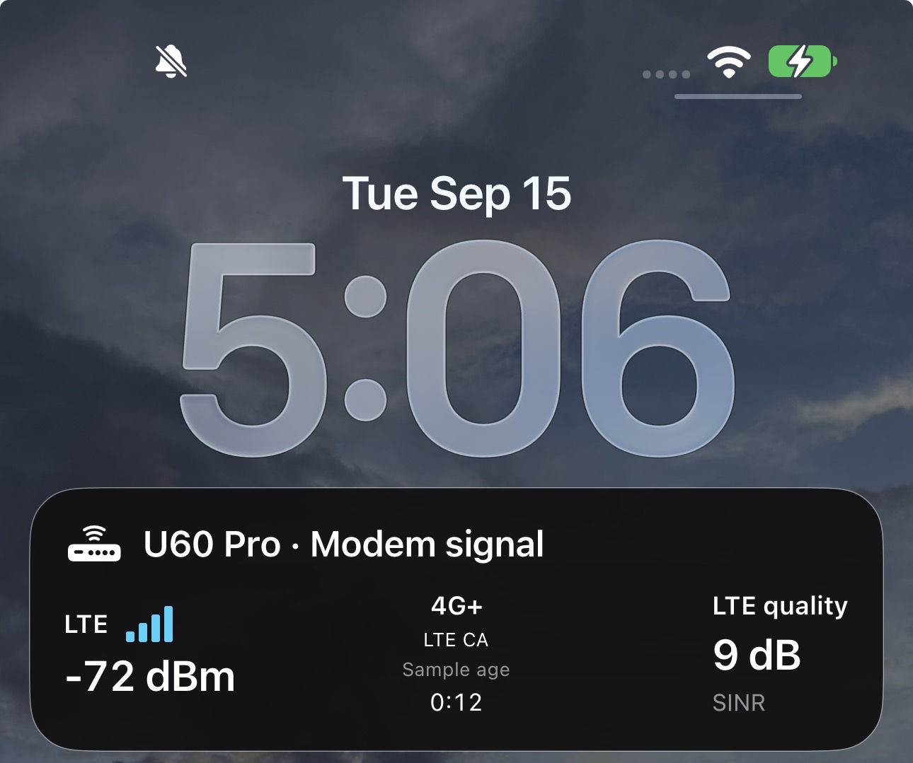
</p>

### Enable the feature

1. **Prepare Apple signing.** Use your own Apple Developer team, an explicit app
   bundle ID with Push Notifications enabled, a matching provisioning profile,
   and an APNs authentication key (`AuthKey_<KEY_ID>.p8`). Update the app and
   extension bundle IDs/signing in
   [project.yml](mobile/ios/OpenU60/project.yml). The ActivityKit manager,
   Live Activity extension, and Live Activities Info.plist flags are included.
   The current iOS project targets iOS 17 or later.
2. **Configure the modem.** Copy your `.p8` and an edited
   [example configuration](zte-agent/config/live-activity.example.json) to
   `/data/zte-agent-apns/`. Set `enabled` to `true`, fill in your Team ID, Key ID,
   containing-app bundle ID, and key path. Match `environment` to the installed
   build: `sandbox` for development, `production` for TestFlight/App Store.
   Keep the directory root-owned with mode `700` and both files mode `600`.
3. **Enable the agent sender.** Preserve the existing password and startup
   settings, add the following environment variable to the agent launch script,
   and restart only `zte-agent` to load the configuration:

   ```sh
   export ZTE_AGENT_LIVE_ACTIVITY_CONFIG=/data/zte-agent-apns/live-activity.private.json
   ```

4. **Start on the iPhone.** Install your signed app, connect to the modem, log in,
   and tap **Dashboard → Live signal → Start**. Allow Live Activities in iPhone
   Settings. Lock the phone to see the card, or expand the Dynamic Island on a
   supported iPhone. Tap **Stop** in the app to end the session.

The modem sends directly to Apple Push Notification service (APNs); no hosted
backend is required. Both the modem and iPhone need internet access for push
updates. Keep private keys out of Git and the app bundle; self-hosting developers
use their own credentials. See the [full setup and API guide](zte-agent/docs/live-activity.md)
for file provisioning, signing, and configuration details.

### Freshness and recovery

- The default send interval is **15 seconds**, with readings marked stale after
  **30 seconds**. Apple controls delivery, so this is not a guaranteed refresh
  rate. Sample age should reset when a newly sampled update reaches the phone.
- Sessions last **one hour**. Currently the agent holds **one registration**;
  starting an activity on another phone replaces it. Agent restarts clear that
  registration; reopen the app to register again, or use Stop/Start if needed.
- SIM removal/ready and WAN events trigger agent recovery. It verifies internet
  access and UTC before resuming delivery, retaining an unexpired registration.
- **Apple accepted an update** confirms submission, not phone delivery. During
  physical testing after a SIM swap, agent sends recovered but the iPhone stayed
  stale until Wi-Fi was toggled off/on. If this happens, reconnect the iPhone's
  Wi-Fi and check sample age. Fully automatic phone-side recovery is not yet
  verified; see the [SIM-swap test findings](zte-agent/docs/sim-swap-ubus-2026-09-15.md).

## License & Disclaimers

This project is licensed under the [MIT License](LICENSE), except:

- `euicc/` (the eSIM card library linked into zte-agent) is a Rust translation of [lpac](https://github.com/estkme-group/lpac)'s libeuicc and stays under the **LGPL-2.1-only** ([`euicc/LICENSE`](euicc/LICENSE)).

[`THIRD_PARTY_NOTICES.md`](THIRD_PARTY_NOTICES.md) lists everything the zte-agent binary contains and is published with every release.

**Disclaimer:** This software is provided "as is", without warranty of any kind. Use it at your own risk. The authors are not responsible for any damage to your device, voided warranties, or other consequences arising from the use of this software.

- **Not affiliated with ZTE Corporation.** This is an independent community project.
- Intended for use on devices you personally own.
- Reverse engineering was performed solely for interoperability and educational purposes.
- Encryption keys and protocol details are sourced from publicly available community research.
- No proprietary source code from ZTE is included in this repository.
