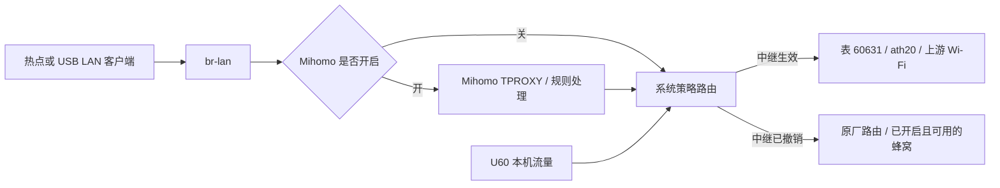

# 中继、蜂窝与热点的切换流程

更新：2026-11-03；2026-11-12 更新 DFS 开关、宽度复位、阶段和取消。适用当前 U60 Pro B31 实现。

## 连接方案

热点操作集中在 `src/wifi_relay/hotspot.rs`，按上游频段只选择一次方案。

| 上游 | 唯一准备方案 | 成功后 | 退出时 |
|---|---|---|---|
| 2.4 GHz | 保存 `wlan0` 运行参数；`disable → set → enable`，切至上游主信道、20 MHz | `ath20` 与上游协商自己的带宽；本次 W 为 40 MHz，热点为 20 MHz | 先解除 STA，再恢复原热点参数并启用；SSID、密码、持久信道配置不变 |
| 5 GHz，含 DFS | 保存 `wlan2` 实际主频、带宽、中心频率；确保固件允许切信道（厂商键 `wireless.zte_mbb.dfs_channel_switch_disable=1`，再 `disableDfsCS 0`）；`chan_switch` 至驱动允许的非 DFS 5 GHz 信道、20 MHz | 关联上游，由驱动让热点跟随；本次 5 GHz 上游为 STA/AP 52/160 | 先解除 STA，再按保存值 `chan_switch` 回原热点；等待雷达检测和实际读回确认 |

5 GHz 不再分 DFS 专用连接和非 DFS 直接连接。2.4 GHz 没有采用同一 CSA
方案的实测依据：6/40 → 1/20 成功，但请求恢复 6/40 后实际保持 6/20；
厂商热点重启才恢复 40 MHz。因此保留本机验证过的 disable/set/enable。

扫描、可选网络过滤、连接前检查和 5 GHz 准备信道选择，共用 `scan::Channels`
解析的 PHY 能力。程序不越过驱动的国家/禁用信道限制。

始终保持上游协商带宽。自动调优（探测、挑战、窄档定时重设）及其采样器、
`/api/wifi-relay/tuning` 和网页选项在 v6 删除；以前按网络保存的“自动调优”读作保持协商带宽，
下次写入时去掉该字段。每次新关联后的那次宽度复位（`wifi_relay/width.rs`）在 2026-11-12 删除：
驱动残留的窄档只来自 `iwpriv … chwidth` 写入（重载驱动才清除），调优器删除后唯一的写入者就是复位本身
（报告 B）。现在 agent 不运行 `chwidth`；手工试验过窄档后要自己设回。

## 数据路径

- IPv4：先安装上游地址、路由表、NAT、转发保护和 DNS，再加入选路规则，避免
  流量先切到尚未配置完成的接口。局域网管理、Tailnet、本地地址等保留原有路径。
- IPv6：按请求及上游能力配置独立地址/路由、LAN RA/NAT66；缺失时仍可使用
  IPv4。在中继活动期间阻止客户端绕到蜂窝 IPv6。
- DNS：普通 DNS 跟随上游；开启 Mihomo 时保留其拦截优先级；本地管理域名
  仍由本地 DNS 处理。退出时移除中继自己增加的配置，保留原厂内容。
- Mihomo：出口真正移动（换接口、接口重建、丢了源地址）或首次出现时重启其运行
  实例，保留原来的模式/日志等级，丢弃旧出口的长连接和 UDP 状态。撤销中继后
  没有出口时不重启，等新出口出现再重启一次；同一接口上之后补上的 IPv6 不再
  重启。所以一次中继切换只重启一次核心。
- 蜂窝开关独立于中继。开启蜂窝不会覆盖活动的中继选路；关闭蜂窝也不关闭中继。
  中继退出只释放自己的路由，**不会主动开启蜂窝、发起拨号或改 APN**。如果蜂窝
  未开启、无服务或无有效路由，退出中继后就没有外网。

## 操作与恢复

### 连接或更换上游

1. 校验扫描选择、加密方式、密码及驱动开放信道。无效请求保留当前连接和恢复选择。
2. 从已发布扫描列表校验选择后，先取消旧的重启恢复任务，再取得准入并排入 `relay` 控制器。扫描、连接、清理、设置、tick 和恢复都由该线程串行执行，执行时登记 `RELAY_OPERATION`。车主操作对准入和开始执行合计最多等 3 s（`admission::WAIT`），忙时回带 `phase` 的 HTTP 409，已放弃的请求随后跳过。开始后调用方等待设备结果，选择校验只取快照短锁。车主 Connect 抢占正在 join 的恢复未在真机验证。
3. 若已有中继：新旧上游都在 5 GHz 时交接（`handover`），只拆旧会话的硬件路径、IPv6、
   路由、解析器、租约和关联，`ath20`、supplicant、防护、热点恢复日志和离线门户的抑制（开关改动和两条 RETURN，都在
   `dns.json`）留给新会话，热点只回
   非 DFS 的 20 MHz 过渡信道（不需雷达检测），跳到第 5 步；重连同一个 AP 且 IPv6 已配好时，
   IPv6 也原样交接，不再重新获取；交接失败或涉及 2.4 GHz 时，
   调用共用清理流程，恢复原热点，再准备新连接。
4. 先装上游防护（nft `u60_relay`：上游进来的只放已建立连接和 DHCP，经上游的转发全部丢弃；legacy 只留放行，v5），再创建独占 `ath20`（2026-11-12 之前叫 `u60sta0`）、起 supplicant；按频段准备热点。
5. 仅扫描选中上游的频率，关联、DHCP、安装路由/NAT/DNS/可选 IPv6；nft 表在策略规则切走流量之前扩展（转发、DNS、IPv6 基线；IPv6 租约有效后再加 NAT66）。
6. 再次检查取消代次和热点开关；成功后发布会话，保存允许重启恢复的选择。

连接时的“记住网络”保存凭据；“重启后恢复”只指最近一次成功选择，不是所有已保存
网络轮询。手动连接也受取消代次约束，取消后不能发布迟到的成功结果。

### 手动取消/断开中继

Disconnect 先更新取消代次和待断开标志，立即发布 `disconnecting`。已有操作时回 HTTP 200，表示接受取消，
控制器在处理下一条消息和发布取消结果之前执行拆除；空闲时请求等待控制器拆完，可能等热点回原信道。
拆除清除 `resume.json`，使以后重启也保持中继关闭；已记住的 Wi-Fi 凭据仍可保留。
两种情况都按同一条清理路径执行：

1. 撤销 IPv6；nft 表缩回仅上游防护后，撤销 IPv4 中继路由/NAT/放行规则及 DNS/离线门户覆盖。
2. 让 Mihomo 跟随当前可用出口。
3. 停止 DHCP，断开 supplicant，并确认驱动的 STA 已解除关联。
4. 恢复原热点运行参数，再移除漫游设置、上游防护（nft 表与 legacy 放行）、专用接口和临时文件。

**取消中继通常不会关闭原热点。** 2.4 GHz 恢复原运行信道/能力，5 GHz 恢复
原主频/带宽/中心频率。恢复 36/160 可能需要约 60 秒 CAC；5 GHz 等待每秒查询，
以 80 秒实际时间为截止，每条查询也有超时。失败保留剩余恢复日志供重试。

2026-11-12 批次 4 真机补记：拆除期间状态请求在 0.00–0.01 s 返回，额外四次 Disconnect 各在 0.01 s
回 HTTP 200；扫描和省电请求各等 3.02 s 后回 HTTP 409，带 `disconnecting`，没有误报需要恢复
（`measurements/b4-final/phase-test.log`）。无其他操作时 Disconnect 用 65.085133 s 拆完并返回
（`measurements/b4-final/phase-test-2.log`）。这些文件位于仓库旁的
`../probe-reports/2026-11-11-relay-mihomo/measurements/`；更多验证边界见[批次 4](relay-mihomo-implementation.md#batch-4)。

5 GHz 之间的切换不走这条清理路径：热点留在中继带去的 DFS 信道时，新的关联在同一信道上
也完成不了（B31 实测一直 SCANNING），所以交接时热点先回过渡信道，再随新关联走；
恢复日志里回原信道的撤销始终只有一条，断开时照常执行。W_Game 重连从约 75–85 秒
降到约 8–11 秒，同一 AP 时 IPv6 只断约 1 秒。切到或离开 2.4 GHz 仍走清理路径，会付出 CAC 的时间。

### 关闭热点

| 入口 | 行为 |
|---|---|
| 本项目 API/网页修改或关闭热点 | 中继活动或恢复未完成时返回 409，提示先断开/恢复中继；清理后才执行热点设置 |
| 原厂界面、设备控制等直接关 Wi-Fi/相关频段 | `relay` 控制器在下一轮 tick 检测到明确 OFF 并清理中继；只有车主自己的开关（`wifi_onoff_by_user`，或射频、SSID 的 `disabled`，`hotspot::off_by_owner`）才取消恢复选择；撤销时跳过已关闭/移除热点的旧快照，不重新启用它 |
| 在连接/雷达等待期间关热点 | 中止正在进行的操作；OFF 使热点快照失效，继续释放其他中继资源 |
| 重新打开热点 | 由原厂配置重新创建热点；之前因 OFF 取消的中继不会自动重连，需要重新选择 |

2.4 GHz 中继依赖匹配的 2.4 GHz 热点以及承载 STA 的 5 GHz 主接口；5 GHz 中继
依赖 5 GHz 主热点。只关闭不相关频段，不主动结束仍可工作的中继。
当前检测依据已提交的开关/接口状态；任意外部工具只改 hostapd 内存而不更新
原厂配置的操作，不等价于已验证的正常关闭入口。

### 上游掉线、agent 重启、整机重启

- **上游掉线/辅助进程退出/租约变化**：`relay` 控制器约每 3 秒检查，清理中继并恢复
  原热点。运行中不循环自动重连；保留重启恢复选择，便于之后 agent 重启时尝试。
- **agent 同一开机内重启/升级**：agent 意外退出时，独立的守护进程重跑启动脚本拉起它
  （OTA 试运行和有意停止除外，Q1）。上一个 agent 留下的连接仍然有效时（关联还在、
  租约一致、日志属本次开机），新 agent 直接接管（`wifi_relay/adopt.rs`）：保留
  supplicant、`odhcp6c`、路由和表，只换掉 IPA 监听进程，重开 DHCP 客户端续同一地址；
  IPv4 不中断，B31 上约 1–1.5 s 完成，Mihomo 只启动一次。接管不成立时才清理残留辅助
  进程，撤销旧运行状态（撤掉路由后通知 Mihomo），再恢复 Mihomo 和最近的上游选择。最多
  按退避策略尝试约 17 分钟，手动连接、断开或明确关闭热点会取消重试。
- **整机重启**：日志携带 boot ID；旧开机的运行快照不会覆盖新启动的原厂热点。
  等原厂启动栅栏后，根据保存选择重新扫描和连接。2026-11-12 批次 3 构建第一次尝试在开机 72.9 s 恢复
  （`measurements/b2-reboot3/agent-boot.log`）；同日批次 4 构建第一次尝试在开机 76.053 s 恢复
  （`measurements/b4-final/agent-boot.log`）。两次是各自构建的记录，不是恢复时限。
- **和 2026-11-12 之前的版本（站点叫 `u60sta0`）互相更换**：两边都不认对方留下的中继（旧接口名的助手、日志和
  规则不再识别，车主决定不留兼容，2026-11-12）。更换之前先断开中继，或者更换之后重启。
- **低电量关机后的关机充电模式**：恢复供电后路由器进入厂商的关机充电模式，Wi-Fi 不启动，厂商把
  `wireless.zte_mbb.wifi_onoff` 设成 0，而车主自己的开关 `wifi_onoff_by_user` 仍是 1
  （`measurements/observations-2026-11-12.md`）。之前的版本按 `wifi_onoff` 判断，把它当作车主关了热点，清除了
  `resume.json`，之后正常重启也不再恢复中继（2026-11-12 实测一次）。现在按 `hotspot::off_by_owner` 判断：
  开机恢复在 Wi-Fi 被固件关着时跳过这次尝试，保留重启选择；连接中途 Wi-Fi 被固件关掉而失败时也保留。这个修复
  只有单元测试，路由器上没有复现。
- **清理中途失败**：已完成的步骤不重做，未完成 undo 留在日志；操作结束后阶段为
  `recovery_pending`，才显示 `recovery_required`，可以再次断开/清理，必要时 USB 执行 `network-recover`。

### 状态阶段与请求边界（2026-11-12）

状态只读内存，`phase` 为 `idle`、`scanning`、`connecting`、`active`、`recovering`、`disconnecting` 或
`recovery_pending`；`recovering` 包括等待关联恢复和 agent 启动恢复，实际扫描/连接步骤显示对应阶段。
只有日志尚存、阶段为 `idle`/`recovery_pending` 且没有待断开时，`recovery_required` 才为真。
扫描、连接、恢复、拆除中不因日志存在而显示“需要恢复”。`autostart`、日志状态、IPACM 配置/开关、省电意图和
已保存网络在 `publish` 时计算；conntrack 历史用独立短锁，GET 不等 tick 或删除。顶层恒定字段
`experimental`、`cellular_fallback`、`internet` 已删除，`ipv6.internet` 保留。

扫描、连接、省电、硬件转发开关、忘记网络和时钟六类请求共用上述 3 s 资格等待规则；忙时回 HTTP 409 和当前
`phase`，其他操作失败仍回 503，HTTP gate 的等待是另一层限制。页面显示各操作阶段，操作中仍提供 Disconnect，
接受取消后写“Disconnect requested”，拆完才写“Relay disconnected”。

## 审查与性能取舍

- 删除 DFS/非 DFS 双连接路径，热点操作集中到一个模块；信道事实只解析一次。
- 修正外部 OFF 被恢复覆盖/留下日志、无效请求清除恢复选择、手动连接无法取消、
  长 CAC 延迟出口重绑的问题。保留单一回滚流程，不新增“快速替换”状态机。
- 400 次固定轮数改为实际时间截止；CAC 期间不再每 200 ms 拉起进程。
- 自动窄带试探在 W 上实测导致丢包和 DNS/HTTPS 超时，恢复 40 MHz 即正常；默认
  保持协商带宽。实验调优实现在 v6 删除，关联时的宽度复位在 2026-11-12 删除。
- 单频扫描、DFS 切换开关、持久 undo 日志分别有驱动实测和
  崩溃恢复依据，删除会重新引入已复现故障。
- Strict Clippy 被仓库其他模块既有告警阻塞；此次中继改动没有新增 Clippy 诊断。

真机结果及范围见 [2026-11-03 验收记录](2026-11-03-dfs-acceptance.md)。本次证明
设备自身联网，不宣称已完成全部信道、冷启动、雷达事件或下游满载吞吐测试。
